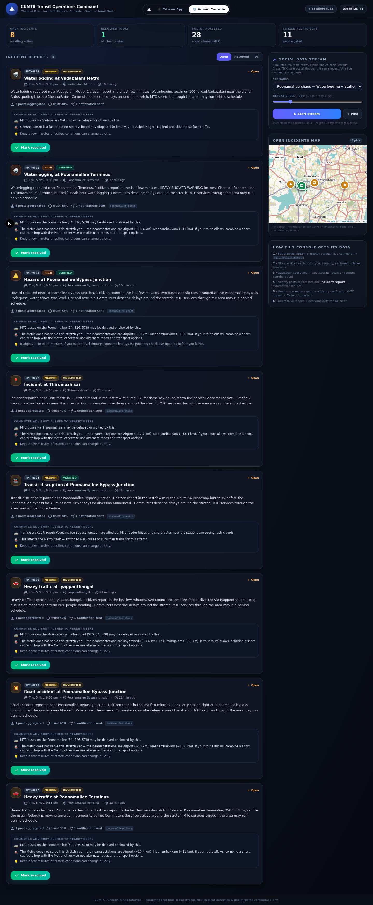
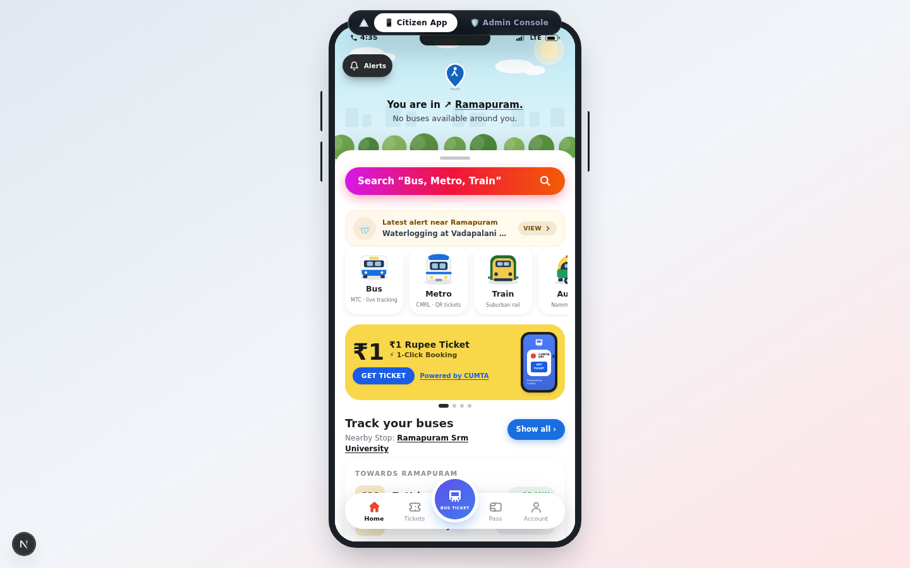
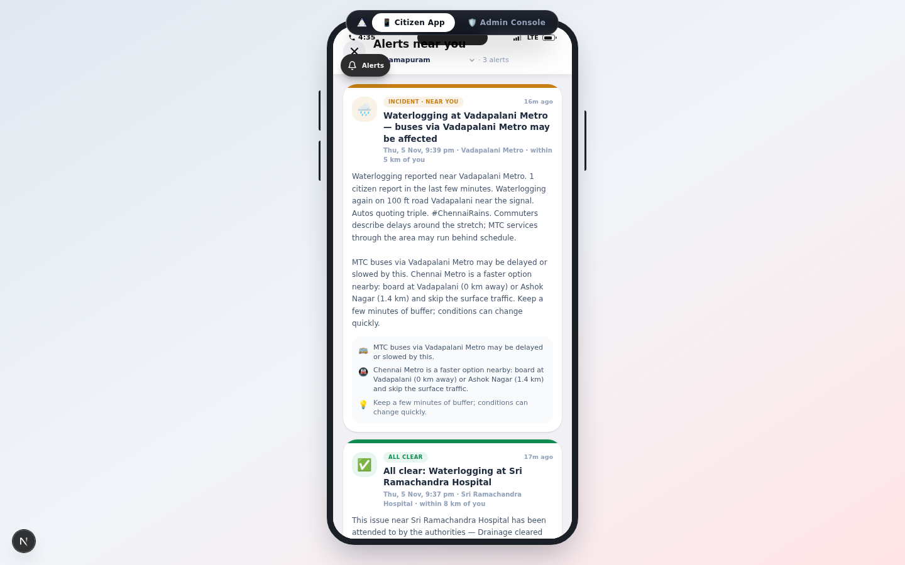

# Chennai One 🚌🚇

**A citizen transit app + CUMTA-style incident operations console for Chennai — where the city's social media chatter becomes live incident reports, geo-targeted commuter alerts, and one-click all-clears.**

> ⚠️ **Unofficial student prototype.** Everything is simulated: the "real-time" social stream is a labeled 131-post corpus replayed through the same ingest API a live connector would use. No real CUMTA / Government of Tamil Nadu affiliation. Built on a ₹0 budget — LLM features use the free-tier Z.ai SDK with heuristic fallbacks.

---

## The idea

When something goes wrong on Chennai's roads — waterlogging at Poonamallee, a stalled lorry on the bypass, a metro signalling fault — the city already knows within minutes. It's all over Instagram, X, Facebook and Telegram. **Chennai One turns that chatter into actionable information:**

1. **For commuters** (📱 phone app) — *"...MTC buses through Poonamallee are crawling. Metro doesn't cover it yet — nearest stations are X & Y, ~6 km away. Budget 30 extra minutes or take a cab hop to the Metro."* — delivered **only to users near the incident**.
2. **For the transit control room** (🛡 admin console) — a summarised incident report with date, time, place, severity, trust score and the advisory that went out. One click to **resolve** → every nearby user gets the all-clear.

## Screenshots

| 🛡 Admin — CUMTA Transit Operations Command | 📱 Citizen app — home + area alert |
|:---:|:---:|
|  |  |

| 📱 Incident advisory (bus / metro / extra-time guidance) |
|:---:|
|  |

## How the pipeline works

```
Social posts (replay corpus / inject / future live connector)
        │
        ▼
POST /api/social/ingest ──►  LLM classification (Z.ai GLM, 30s timeout)
        │                      type · severity · sentiment · places · summary
        │                      (heuristic fallback if the LLM is unavailable)
        ▼
Gazetteer geocoding ──► Chennai place names → lat/lon (60+ entries)
        ▼
Trust scoring ──► source credibility · content signals · corroboration
        ▼
Incident clustering ──► posts within 2.5 km + 90 scenario-minutes merge
        │                into one IncidentReport, LLM-summarised
        ▼
Geo-targeted alerts ──► users within the severity radius get a
        │                notification: MTC impact + Metro alternative
        ▼
Admin resolves ──► "✅ All clear" pushed to the same area
```

### Geo-targeting radii

| Severity | Alert radius | Who gets it |
|---|---|---|
| low | 3 km | immediate neighbourhood |
| medium | 6 km | nearby areas |
| high | 10 km | covers the affected corridor — e.g. a user in Ramapuram (~9 km from Poonamallee) is alerted |
| critical | 14 km | escalation — city-wide awareness for major events |

Escalations (a high-impact official/News post absorbed into an existing report) re-notify at the wider radius. Reports that exist **outside your alert zone** are never silent: the notifications overlay lists them under "Also happening in Chennai" with the distance and a Preview button, so the geo-targeting is visible rather than reports mysteriously "missing".

### The commuter advisory engine

Each report builds a three-line advisory:

- 🚌 **MTC impact** — which routes/Corridor are affected ("buses via X may be delayed or slowed")
- 🚇 **Metro alternative** — nearest CMRL stations with distance; if a station is within 4.5 km, *"boarding from X station will be faster"*; if the incident *is* a transit disruption, the advice flips to buses/suburban rail
- 💡 **Extra guidance** — realistic time buffers and pre-travel checks

## Replay scenarios

| Scenario | Posts | Story |
|---|---|---|
| **Poonamallee chaos** | 26 | Monsoon waterlogging + stalled lorry at the bypass → MTC diversions → rumours (flagged) → official corroboration → critical escalation → recovery → all-clear |
| Monsoon flood | 49 | City-wide NE monsoon downpour, multiple low-lying areas |
| Metro fault | 29 | Peak-hour signalling fault on the Blue Line |
| OMR incident | 27 | Accident + bus breakdown on the IT corridor |

Replay speed is adjustable (10×–120×) from the admin console.

## Tech stack

- **Next.js 16** (App Router) + TypeScript + Tailwind CSS 4 + shadcn/ui
- **Prisma ORM + SQLite** (`IncidentReport`, `UserNotification`, `SocialPost` models)
- **Leaflet** maps (OSM tiles) with custom pulse markers
- **Z.ai SDK** (GLM) for classification & report digests — heuristic fallback included
- **Bun** runtime, ESLint clean

## Run it locally

```bash
# 1. install
bun install

# 2. configure the database (SQLite — no server needed)
cp .env.example .env
bun run db:push        # creates db/custom.db from prisma/schema.prisma

# 3. start
bun run dev            # → http://localhost:3000
```

### 90-second demo script

1. Open **http://localhost:3000** → the citizen phone app boots (user is in *Ramapuram*).
2. Hit **🛡 Admin Console** (top toggle) → *Social data stream* → scenario **Poonamallee chaos**, speed **120×** → **▶ Start stream**.
3. Watch reports **pop up live** in the feed (date · time · place · severity · LLM summary · trust · advisory).
4. Toggle back to **📱 Citizen App** → push-style toasts arrive for incidents near Ramapuram; the bell and home banner light up. Open the bell → full advisory card (🚌 / 🚇 / 💡), plus an **"Also happening in Chennai"** strip showing farther incidents with their distance. Switch the demo area to *T Nagar* (~15 km away) → far fewer alerts — geo-targeting working.
5. Back in **Admin** → pick a report → **Mark resolved** → add a resolution note → **Confirm**.
6. Back to the **phone** → *"✅ ALL CLEAR — …your resolution note…"* arrives for the same area.

## Repo structure

```
src/
  app/                     # the single "/" route + API routes
    api/social/            #   ingest · feed · replay · reset (simulated stream)
    api/reports/           #   list reports · resolve (+ all-clear fan-out)
    api/notifications/     #   geo-filtered alerts · mark-read
  components/app/          # ChennaiOneApp (phone) + AdminConsole (command center)
    screens/               #   Home · City Pulse · Tickets · Pass · Profile…
    subscreens/            #   NotificationsOverlay · Planner · BusDetail…
  lib/social/              # the pipeline: classify · gazetteer · trust · reports
  lib/alerts.ts            # shared advisory/alert types (client + server)
prisma/schema.prisma       # SocialPost · IncidentReport · UserNotification
scripts/corpus/            # scenario corpus builders → data/social/corpus.jsonl
docs/screenshots/          # the images in this README
.env.example               # database config template (copy to .env)
```

## Notes & limitations

- Simulated real-time only — a live connector would post to the same `/api/social/ingest` endpoint.
- The LLM layer degrades gracefully: no key / timeout → keyword heuristics keep the whole pipeline running.
- Map data © OpenStreetMap contributors; transit concepts inspired by CUMTA / MTC / CMRL public information.
